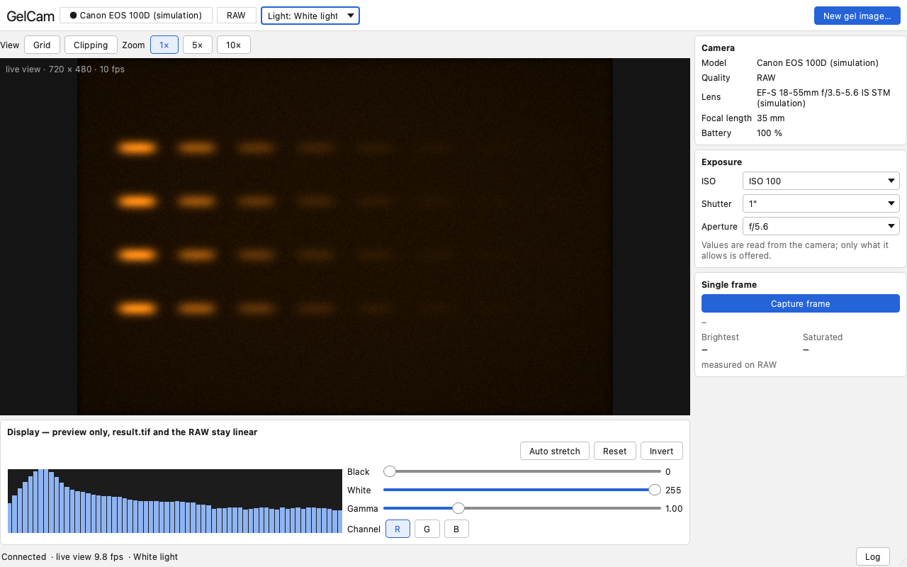
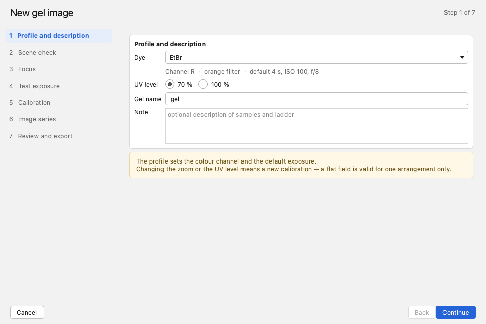
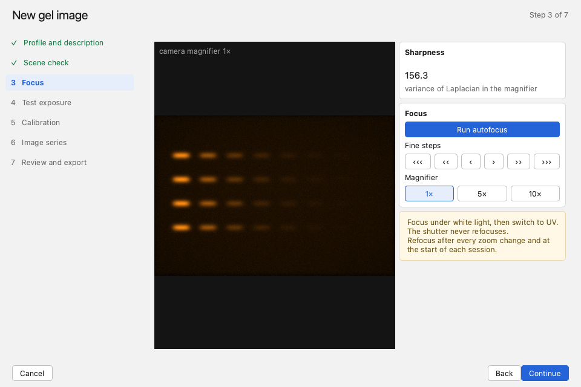
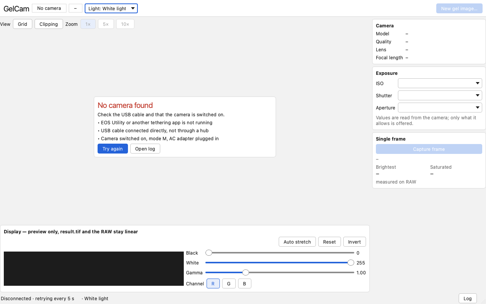

# GelCam

Tethered capture and quantification-grade processing of agarose gel images with a **Canon EOS
100D**. Live view with focus aids, a seven-step capture wizard, and a pipeline that improves the
image by physics rather than cosmetics — frame stacking, dark-frame subtraction, flat-field
correction, colour-channel selection from the CFA mosaic, binning — ending in a linear 16-bit
TIFF you can quantify.



## Why it exists

The lab photographs PCR gels in a dark cabinet with the camera mounted above. Canon's EOS
Utility 2 crashes on launch on Windows, and the alternatives either have no workflow for gels or
are paid. GelCam replaces them with a tool that knows what a gel image is for: the numbers in
`result.tif` have to survive quantification.

Three rules the application does not break:

1. **The original RAW is never modified.** `result.tif` contains only linear operations applied
   to the whole image — subtraction, division by the flat, averaging, binning.
2. **Brightness, contrast, gamma and inversion affect the preview only.** The display settings
   are recorded in `metadata.json` and used for `preview.png`; they never touch the TIFF.
3. **No AI denoising.** It can suppress a faint band or invent structure that was not there —
   fatal for quantification and against journal policy. Classical denoising is optional and
   always written as a separate file.

## Screenshots

The images are rendered from the running application over the simulated camera
(`uv run python tools/screenshots.py`), so they show the real UI, not mockups.

| Wizard — profile and gel description | Wizard — focusing |
| --- | --- |
|  |  |

The focus step reads sharpness as the variance of the Laplacian inside the camera's own
magnifier, because the cabinet's focus ring is out of reach and the only way to focus is through
the software. When the camera is missing or busy, the window says which application is holding
it instead of failing silently:



## Status

| Part | State |
| --- | --- |
| Camera control over Canon EDSDK | verified on the 100D — live view, autofocus, RAW enforcement, reconnect |
| Processing pipeline | complete — calibration, stacking with sigma clipping, alignment, binning, export, CLI |
| Live view window and capture wizard | prototype over the simulated camera, not yet run on Windows with the camera |
| Dye profiles, flat library, settings | designed, not implemented |
| Packaging and lab pilot | not started |

`uv run pytest` → **197 passed**. Detailed state and the ordered next steps: [STATUS.md](STATUS.md).

## Running

```
uv sync
uv run python -m gelcam --mock      # simulated camera, works on any OS
uv run python -m gelcam             # Canon EOS 100D over EDSDK (Windows)
uv run pytest                       # tests
uv run python tools/bench.py        # is this machine fast enough?
```

Process already captured frames without the GUI:

```
uv run python -m gelcam.processing --help
```

## Setup on another computer (Windows)

1. Install Git and `uv` (no administrator rights needed: `winget install astral-sh.uv`, or see
   https://docs.astral.sh/uv/).
2. `git clone https://github.com/dreryos/gelcam`, then `uv sync` in the directory — it downloads
   Python 3.12 x64 and the dependencies.
3. `uv run pytest` — the tests run without a camera. Tests over real RAW files are skipped when
   `testdata/` is absent.
4. **Canon EDSDK** (only for camera work): download it from the Canon Developer Programme
   (tested with 13.21.10, `EDSDKv132110W`), copy the 64-bit `EDSDK_64/Dll/*.dll` into
   `vendor/edsdk/Dll/` and `EDSDK/Header/*.h` into `vendor/edsdk/Header/`, then run
   `uv run python tools/check_edsdk_constants.py` and `uv run python tools/edsdk_smoke.py`.
   The `vendor/` folder is never committed (Canon licence).
5. Close EOS Utility, digiCamControl and similar programs before starting with the camera.
6. **Test images** (`testdata/`, CR2 from the 100D, about 2.6 GB) are not in git; see
   `docs/GELCAM_PLAN.md`. Without them, development runs on synthetic data
   (`src/gelcam/testing/synthetic.py`) and `MockCamera`.

## Working on macOS or Linux

The UI and the processing pipeline run anywhere; only the real camera is tied to Windows.

- **Everywhere:** PySide6 UI and `uv run python -m gelcam --mock`, the pipeline (`rawpy`,
  `numpy`, `tifffile`, `opencv-python-headless`), the tests, synthetic data.
- **Windows only:** `EdsdkCamera` (calls `EDSDK.dll` through `ctypes` and pumps Windows
  messages), the final UI check (fonts, DPI scaling), PyInstaller packaging, and the test
  without administrator rights.
- **Rule:** nothing in `ui/` or `acquisition/` may call EDSDK directly — only the `Camera`
  interface — otherwise the code stops running off Windows.

## Documentation

- [docs/GELCAM_PLAN.md](docs/GELCAM_PLAN.md) — plan, architecture, measured sensor data and the
  history of every decision
- [STATUS.md](STATUS.md) — where the work stands and what comes next
- [CLAUDE.md](CLAUDE.md) — context and rules for Claude Code
- [docs/TESTOVACI_DATA.md](docs/TESTOVACI_DATA.md) — how to capture the test sets
- `design/` — the UI design: `gelcam-ui.figcraft` plus the scripts that generate it

## Licence

MIT — see [LICENSE](LICENSE). The Canon EDSDK is **not** part of this repository and has its own
licence; obtain it through the Canon Developer Programme and place it in `vendor/edsdk/`.
